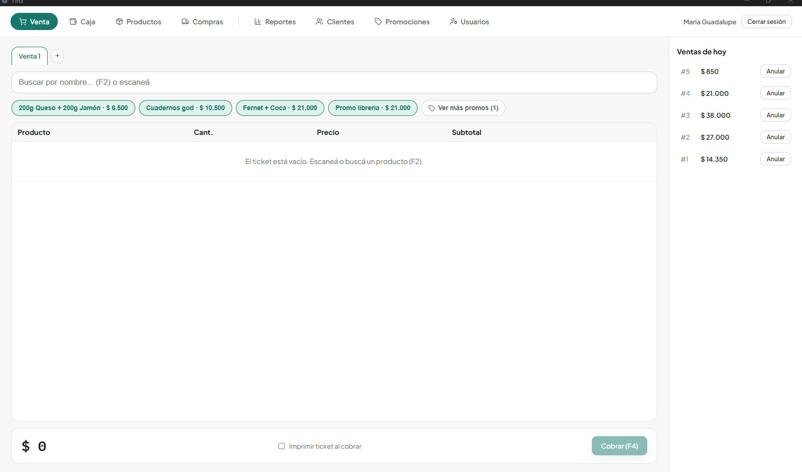

# Vitta · Punto de venta, stock y caja

Aplicación de escritorio para **comercios minoristas** (polirrubros, kioscos, almacenes). Funciona **100 % local, sin internet**, y se instala en Windows como cualquier programa.

Nació para resolver la gestión diaria de un polirrubro real, donde **se usa todos los días**, y está pensada para adaptarse a cualquier negocio minorista.

<!-- Agregar capturas con DATOS DE EJEMPLO (nada del negocio real) en docs/capturas/ y descomentar:

-->

## Funcionalidades

- **Venta en mostrador:** lector de código de barras, varias ventas abiertas en pestañas, búsqueda por nombre, carga al vuelo de productos nuevos y pagos combinados (efectivo + transferencia).
- **Stock:** historial completo de movimientos (ventas, compras, ajustes, mermas), compra por bulto con cálculo de costo unitario y alertas de reposición.
- **Precios:** precio sugerido según el margen, editable por producto.
- **Caja:** apertura y cierre con arqueo; distingue el efectivo del cajón de los cobros por transferencia.
- **Clientes:** fiado y cuenta corriente con límite de crédito.
- **Promociones**, **usuarios con login** y **reportes** de ventas, ganancia y reposición por categoría.
- **Excel:** importación masiva de productos y exportación de reportes.
- **Backup automático** de la base de datos al cerrar la aplicación.

## Stack

| Capa | Tecnología |
|---|---|
| App de escritorio | Electron (`electron-vite`, `electron-builder`) |
| Interfaz | React 19 + TypeScript + Vite |
| Base de datos | SQLite (`better-sqlite3`), con migraciones versionadas |
| Arquitectura | Proceso principal con servicios de negocio, comunicación por IPC con una API tipada expuesta en el `preload` |

## Decisiones de diseño

- **La plata se guarda en enteros**, nunca en `float`, para evitar diferencias de redondeo en el arqueo.
- **Cada venta guarda una "foto" del precio y del costo** de ese momento, para que los reportes de ganancia histórica sigan siendo correctos con inflación.
- **El stock nunca se modifica a mano:** cada cambio genera un movimiento en la misma transacción, así siempre se puede reconstruir qué pasó.
- **Una venta puede tener varios pagos**, y no todos los medios de pago afectan la caja física.

Más detalle sobre el modelo de datos y las decisiones técnicas en [`docs/decisiones-de-diseno.md`](docs/decisiones-de-diseno.md) y [`docs/operacion-y-hardware.md`](docs/operacion-y-hardware.md).

## Cómo correrlo

```bash
npm install
npm run dev        # modo desarrollo
npm run dist:win   # genera el instalador .exe
```

## Autor

**Matías Reina** · [GitHub](https://github.com/Matiassr24) · matiasreina555@gmail.com
